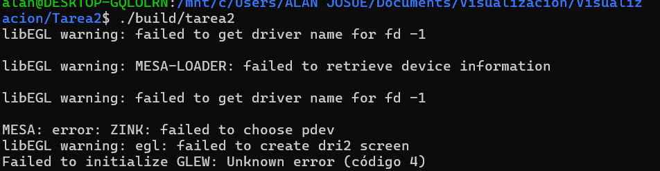
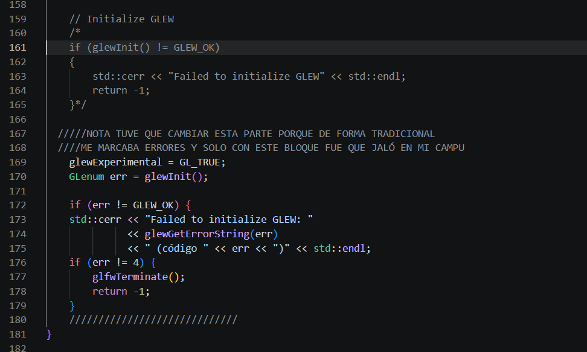
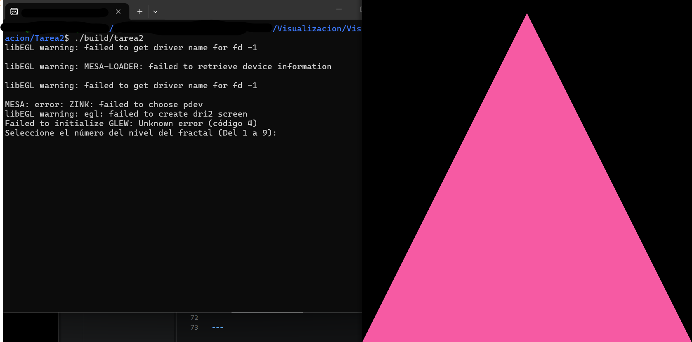
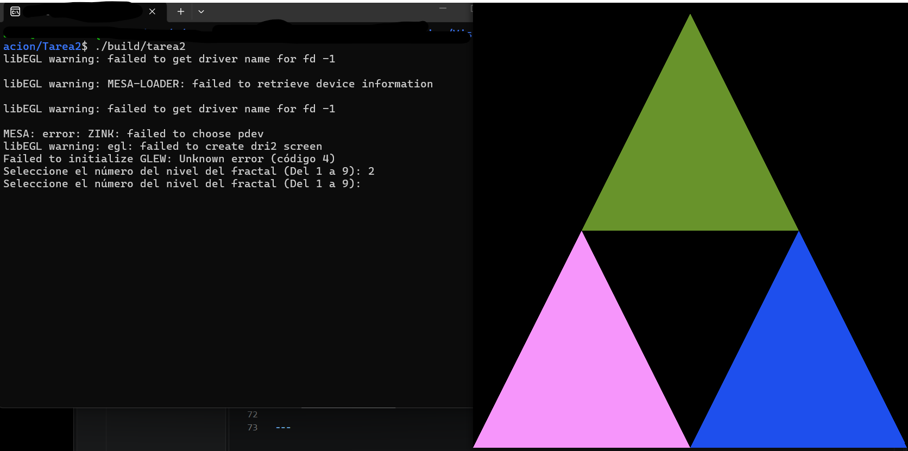
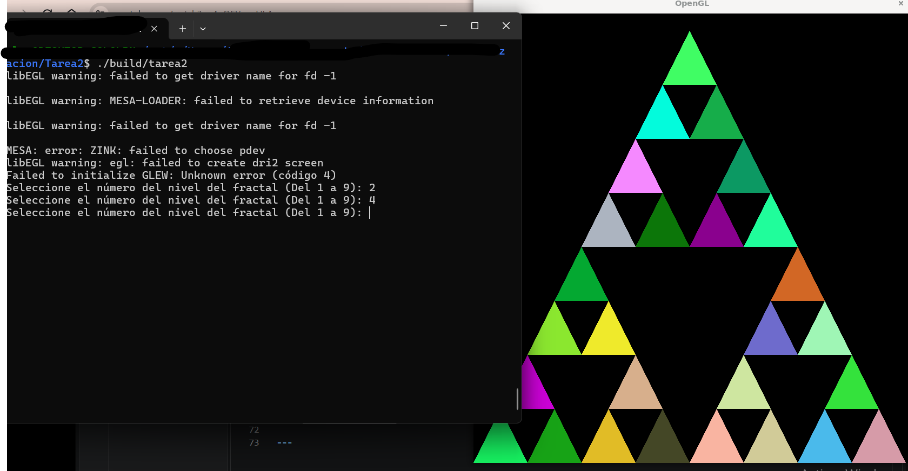
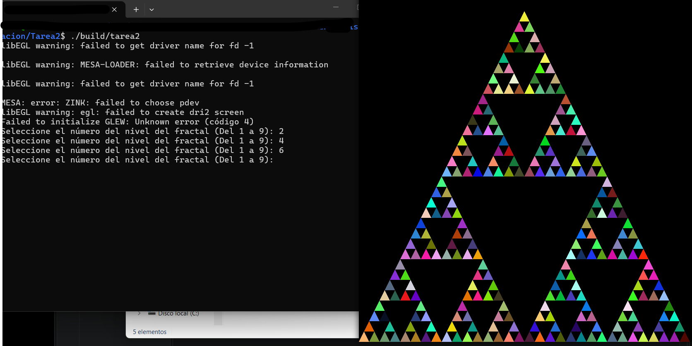
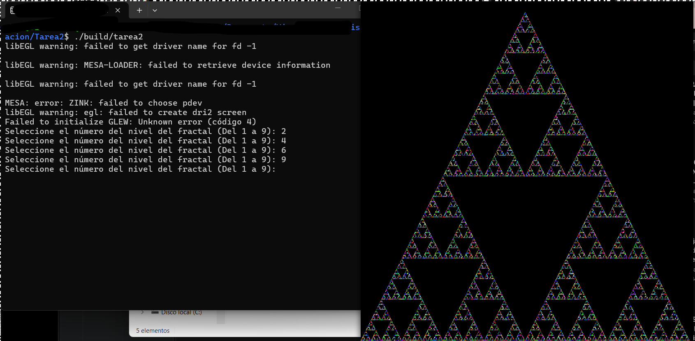

# Tarea 2: Triángulo de Sierpinski

El triángulo Sierpinski es un fractal que se puede construir a partir de cualquier triángulo. La construcción procede como sigue:

* 1.- A partir de un triángulo equilátero inicial con lados de longitud 1 por comodidad, unimos los puntos medios de cada lado y extraemos el triángulo central interno. Después de este primer paso obtenemos tres triángulos iguales, cada uno equilátero y con longitudes que son exactamente la mitad del triángulo inicial.

* 2.- Con los tres triángulos producidos por el paso anterior, procedemos de igual manera a aplicar este proceso generador en cada uno de ellos, para así obtener tres nuevos triángulos por cada uno, lo cual produce finalmente 9 triángulos equiláteros, cada uno a escala $(1/2)^2$ del inicial.

* 3.- Continuamos el proceso anterior en cada uno de los nuevos triángulos que se van generando hasta llegar al límite del proceso. La figura última es conocida como el triángulo T de Sierpinski.
[Wikipedia](https://es.wikipedia.org/wiki/Triángulo_de_Sierpinski)

El objetivo de esta tarea es poner en práctica los conocimientos básicos de **OpenGL** en dos dimensiones. Para ello, completarán la implementación para generar el T triángulo de Sierpinski.

Se provee el código base con la estructura y métodos necesarios. Únicamente deberán completar los siguientes elementos:

* **[src/main.cpp](./src/main.cpp)**:
  * La función *main()* del vertex Shader.
  * La función *main()* del fragment Shader.
  * El caso base de la función *generateSierpinski()*
  * Llenar los parámetros de la función *glVertexAttribPointer()* para los vertices.
  * Llenar los parámetros de la función *glVertexAttribPointer()* para los colores.
  * Llenar los parámetros de la función *glDrawArrays()*.

#### Los triángulos genereados *deben* tener colores aleatorios y por tanto diferentes entre si.


---

## Compilación y Ejecución

1. **Compilar el proyecto:**
   ```bash
   cmake -B build
   cmake --build build
   ```

2. **Ejecutar el programa:**
   * En Linux / macOS:
     ```bash
     ./build/tarea2
     ```
   * En Windows (PowerShell / Command Prompt):
     ```bash
     ./build/Debug/tarea2.exe
     # o ./build/tarea2.exe según el generador de CMake usado
     ```
## Aclaración:
#### En mi equipo uso windows 11 con wsl y cuando ejecutaba "./build/tarea2" no se podía por problemas con mesa loader o algo así

#### Así que modifiqué la parte del GLEW y aunque me salen advertencias en la ejecución ya me permitía ver la renderización de los triángulos


## USO
#### Al correr el progama se pedirá el nivel del triángulo de Sierpinski solo se puede agregar una entrada del 1 al 9, por default muestra el nivel 1
1. **Ingresar un número del 1 a 9 y presionar ENTER**

2. **Para salir es necesario usar ctrl+c o el comando que te permitar matar un proceso de terminal**


#### Nivel 1:


#### Nivel 2:


#### Nivel 4:


#### Nivel 6:


#### Nivel 9:

---